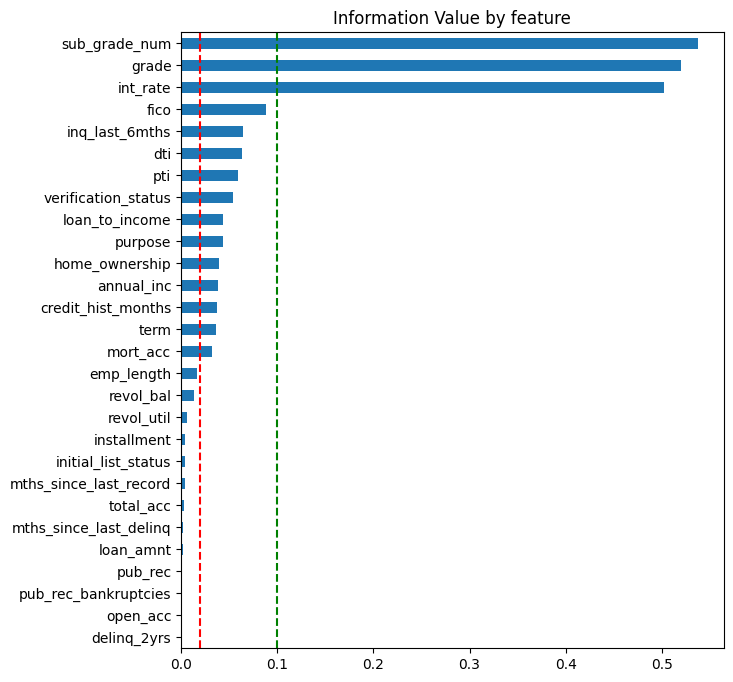
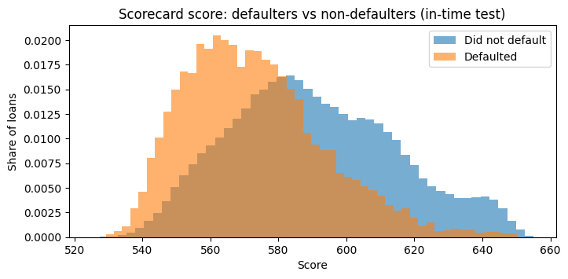
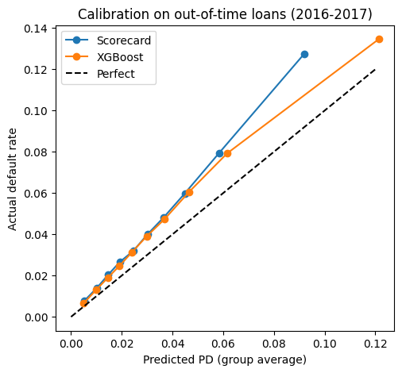
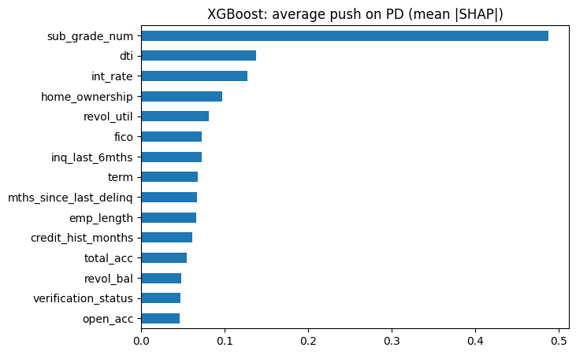
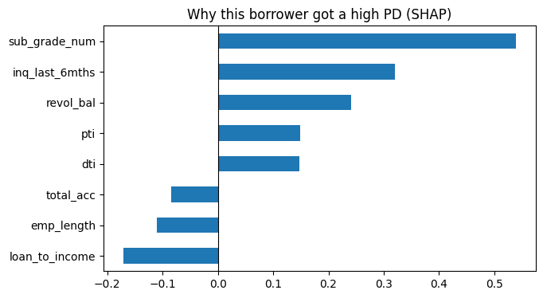
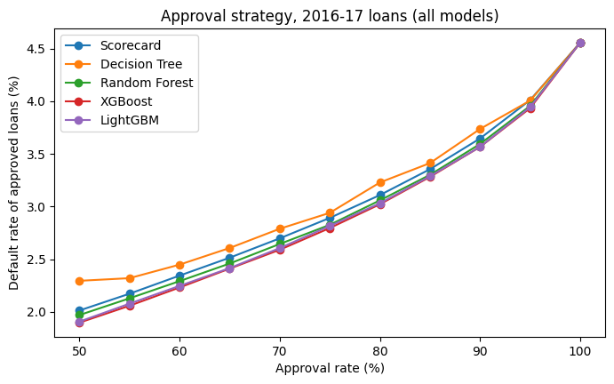

# Credit Default Prediction: Comparing 5 Machine-Learning Models with Bank-Style Model Validation

A 12-month **probability of default (PD)** model for personal loans, built on **1.6 million Lending Club loans (2013–2017)**. A traditional **WoE logistic-regression scorecard** (the bank "champion") is compared with four **machine-learning challengers** (Decision Tree, Random Forest, XGBoost, LightGBM). The models are then validated the way a bank's model validation team would: out-of-time testing, calibration, statistical significance, stability, explainability and business impact.

## Key results (out-of-time test, 826,772 loans issued 2016–17)

| | XGBoost | LightGBM | Random Forest | **Scorecard** | Decision Tree |
|---|---|---|---|---|---|
| Gini | **0.444** | 0.443 | 0.434 | 0.422 | 0.408 |
| Gini 95% CI (bootstrap) | 0.439–0.449 | 0.438–0.448 | 0.429–0.439 | 0.418–0.427 | 0.404–0.414 |
| KS | **0.322** | 0.321 | 0.315 | 0.306 | 0.297 |
| PR-AUC (base rate 0.046) | **0.115** | 0.115 | 0.112 | 0.105 | 0.103 |
| Overfit gap (train − test Gini) | 0.045 | **0.114** | 0.047 | 0.001 | 0.011 |
| Predicted / actual default rate | 0.81 | 0.81 | 0.78 | **0.74** | 0.81 |
| Score PSI (2013–15 vs 2016–17) | 0.009 | 0.007 | 0.013 | 0.021 | 0.017 |
| Defaulters approved at 80% approval | **19,986** | 20,048 | 20,231 | 20,562 | 21,599 |
| Loss at 80% approval ($M, LGD 85%) | **253.0** | 253.9 | 253.0 | 257.9 | 273.3 |
| F1 at 80% approval | 0.174 | 0.174 | 0.172 | 0.169 | 0.164 |
| Explainability | SHAP | SHAP | SHAP | **Points** | One tree |

- **XGBoost ranks risk best:** +0.022 Gini over the scorecard, statistically significant (paired bootstrap, 95% CI 0.020–0.024). It approves 576 fewer defaulters at an 80% approval rate (about $4.9M lower loss).
- **All ranking measures agree** (Gini, KS, PR-AUC, F1). Accuracy does not: the weakest model has the highest accuracy.
- **All models under-predict PD on 2016–17 loans** (74–81% of actual defaults), even though the applicant population was stable (PSI < 0.03). Recalibration is required whichever model is used.
- **Recommendation:** keep the scorecard as champion and run XGBoost as a challenger, because the gain is real but modest and the scorecard is fully transparent.

---

## 1. Problem

A lender must decide, at application time, whether to approve a loan. The key input is the borrower's **probability of default (PD)**. The model must rank applicants well (who is riskier) **and** give the right PD level (for loss provisions and capital).

## 2. Data

Lending Club accepted loans 2007–2018 ([Kaggle: wordsforthewise/lending-club](https://www.kaggle.com/datasets/wordsforthewise/lending-club)), 2,260,701 loans. The file was extracted in **March 2019**.

## 3. Target definition: why not "Fully Paid vs Charged Off"?

In March 2019, 59% of 2017 loans and 86% of 2018 loans were still running. Keeping only finished loans gives a default rate that depends on **how old the loans are**, not on borrower risk (resolution bias):

| Issue year | 2013 | 2016 | 2017 | 2018 |
|---|---|---|---|---|
| "Finished loans only" default rate | 15.6% | 23.3% | 23.1% | 15.7% |
| **12-month default rate (this project)** | **3.2%** | **4.7%** | **4.4%** | n/a |

**Target:** `bad = 1` if the loan reaches 90 days past due (estimated as last payment date + 3 months) or is charged off **within 12 months of issue**, the horizon used for Basel and IFRS 9 PDs. Loans are kept up to Dec 2017 so every loan has a full 12-month window.

## 4. Sample design

| Sample | Issue dates | Loans | Default rate | Used for |
|---|---|---|---|---|
| Train | 2013–2015 (70%) | 553,718 | 3.71% | Fitting all models |
| In-time test | 2013–2015 (30%) | 237,309 | 3.71% | Choosing the best challenger |
| **Out-of-time test** | **2016–2017** | **826,772** | **4.56%** | Final validation only |

Development starts in 2013 because `mort_acc` was not recorded before 2012 (a structural break). Only individual applications with positive income are kept.

**Leakage control:** only the 28 fields known on the application date are used as inputs. Payment and recovery fields are used only to build the target.

## 5. Champion: WoE logistic scorecard

1. **Binning and Weight of Evidence:** each feature is cut into about 10 groups; each group gets WoE = ln(%good / %bad). Missing values get their own group.
2. **Information Value** ranks features; IV < 0.02 is dropped. Lending Club's grade, sub-grade and interest rate (IV ≈ 0.5) carry the same information, so only sub-grade is kept.
3. **Correlation filter:** pti vs loan-to-income (0.91) and home ownership vs mortgage accounts (0.61), so the lower-IV feature of each pair is dropped.
4. **Logistic regression** with checks: all coefficients negative, p < 0.05, VIF < 5. Backward elimination removed `term` (wrong sign, already captured by sub-grade).
5. **Points scaling:** 600 points at 50:1 odds, 20 points to double the odds. Scores range from 493 to 655.

Final scorecard: 10 features (sub-grade, FICO, recent enquiries, DTI, payment-to-income, verification status, purpose, home ownership, income, credit history length). Gini 0.420 train / 0.419 in-time test.




## 6. Challengers: machine-learning models

Decision Tree, Random Forest, XGBoost and LightGBM, trained on all 28 raw features (one-hot encoded categories, missing = −1) with regularised settings. XGBoost and LightGBM tied on in-time Gini (0.450 vs 0.451), but LightGBM overfit strongly (train Gini 0.565), so **XGBoost was chosen as the challenger before looking at the out-of-time data**.

## 7. Validation

**Calibration:** perfect in-time (3.70% predicted vs 3.71% actual), but every model is too optimistic out-of-time.



**Stability:** score PSI < 0.03 for all models. The applicant population looked the same (even slightly safer), yet defaults rose from 3.7% to 4.6%. The deterioration was not visible in application data, which is why **PSI monitoring must be paired with back-testing**.

**Explainability (SHAP):** XGBoost relies on the same main drivers as the scorecard (sub-grade, DTI, home ownership). Part of its extra power comes from features with low IV on their own (e.g. revolving utilisation) that matter in combination, which are interactions a linear scorecard cannot capture. SHAP also gives borrower-level reason codes.




**Business impact:** approving the 80% of applicants with the lowest PD, every model cuts approved defaulters by about a third compared with random approval. XGBoost approves the fewest.



## 8. Conclusion and recommendation

XGBoost is the strongest challenger on every performance measure, and its gain is statistically significant, but modest (+0.022 Gini, about 2% lower loss). The scorecard is fully transparent. **Recommendation:** keep the scorecard as champion, run XGBoost in parallel as a challenger with SHAP reason codes, and switch only if its advantage holds over 6–12 months. **Both models must be recalibrated** to the current default rate before use.

## 9. Limitations

- The default date is estimated (last payment + 3 months); exact delinquency history is not available.
- Only approved loans are observed (no reject inference), so the model never sees applicants Lending Club rejected.
- Lending Club's own grade is an input, so part of the predictive power re-uses Lending Club's internal model.
- ML models use fixed, regularised hyperparameters rather than an extensive tuning search.
- Losses assume LGD = 85% and exposure = loan amount.
- Recalibration is recommended but not implemented here.

## 10. How to run

1. Open a Kaggle notebook and add the dataset [wordsforthewise/lending-club](https://www.kaggle.com/datasets/wordsforthewise/lending-club).
2. Upload `credit_risk_pd_model.ipynb` and click **Run All** (about 15 minutes on Kaggle).

Libraries: pandas, numpy, scikit-learn, statsmodels, xgboost, lightgbm, scipy, matplotlib (see `requirements.txt`).

## Repository structure

```
credit_risk_pd_model.ipynb   full analysis with outputs
README.md                    this summary
requirements.txt             Python libraries
images/                      charts used in this README
```

---

**Author:** Raghav, MSQE, Indian Statistical Institute (Delhi)
